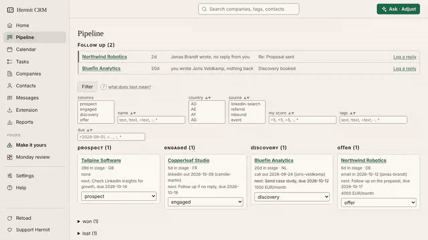
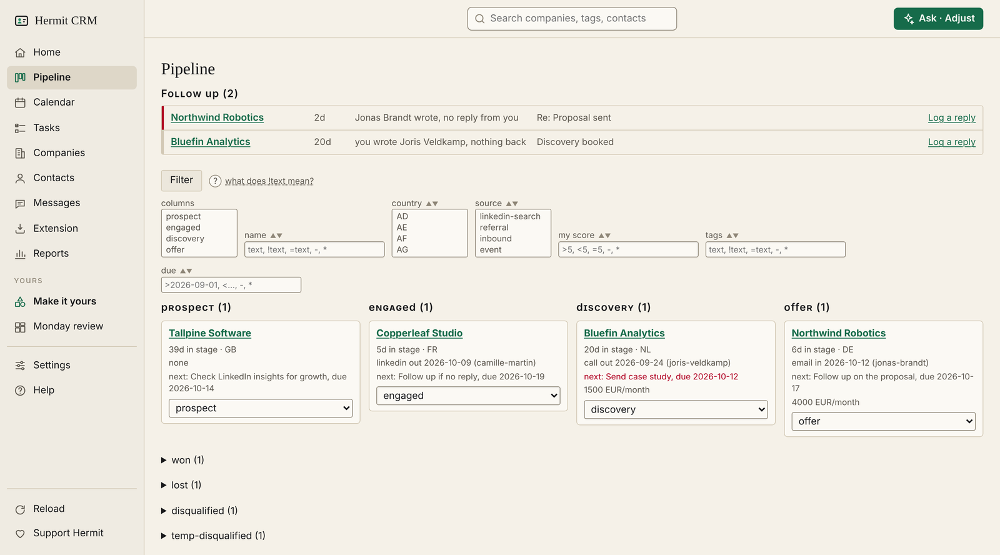
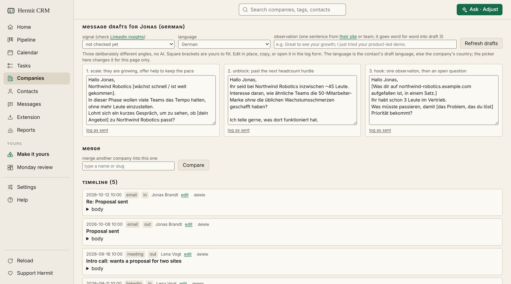
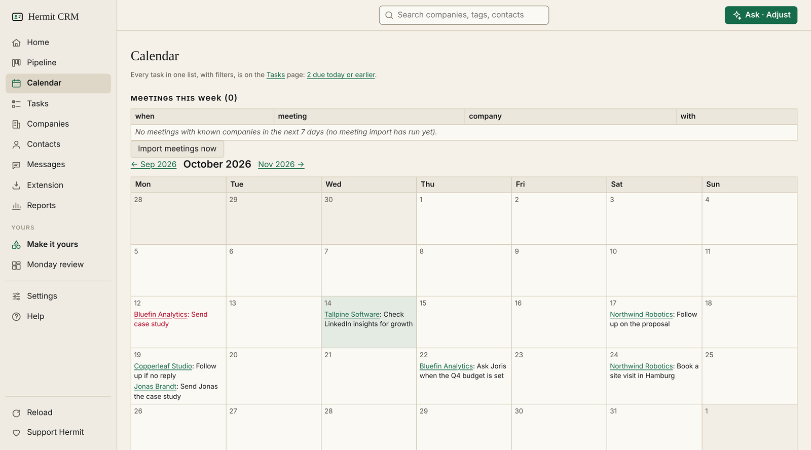

# Hermit CRM

<!-- mcp-name: io.github.Hermit-CRM/hermit-crm -->

**A CRM for one.** A free, open-source CRM for founders, freelancers and anyone
doing their own sales. Your companies, contacts and conversations are Markdown
files in git on your own computer, with a web app for you and a CLI and MCP
server for your AI agent. No account, no cloud.

[](https://github.com/Hermit-CRM/hermit-crm/blob/main/LICENSE)
[](https://pypi.org/project/hermitcrm/)
[](https://github.com/Hermit-CRM/hermit-crm/releases/latest)
[](https://github.com/Hermit-CRM/hermit-crm/actions/workflows/test.yml)
[](https://hermitcrm.io/?ref=readme)



**Version 1.0, stable for daily use.**
[What changed](https://hermitcrm.io/changelog/) ·
[Latest release](https://github.com/Hermit-CRM/hermit-crm/releases/latest) ·
[Docs](https://hermitcrm.io/docs/) ·
[Discussions](https://github.com/Hermit-CRM/hermit-crm/discussions)

> **Use at your own risk.** Hermit CRM 1.0 is stable for daily use, but it is
> free and comes with **no warranty of any kind**, and nobody is on the hook if
> it loses your data. Keep your own backups, and check that they restore. Read
> [DISCLAIMER.md](https://github.com/Hermit-CRM/hermit-crm/blob/main/DISCLAIMER.md)
> before you put real work in it.

## Who it is for

Hermit CRM is built for **one person**: a founder, a freelancer, someone doing
their own sales.

- **It fits if** you want your pipeline in files you own, every change a git
  commit you can undo, and an AI tool such as Claude Code, Codex or Cursor that
  can read and update it as easily as you can.
- **It does not fit if** a team shares the pipeline, you want a hosted service
  with support, or you work on Windows (not supported yet).

The whole data model: a folder per company, a file per contact and a file per
conversation, all small text files you can read, grep, edit and diff.

| Pipeline | A company | Calendar |
|---|---|---|
| [](https://raw.githubusercontent.com/Hermit-CRM/hermit-crm/main/docs/img/pipeline.png) | [](https://raw.githubusercontent.com/Hermit-CRM/hermit-crm/main/docs/img/company.png) | [](https://raw.githubusercontent.com/Hermit-CRM/hermit-crm/main/docs/img/calendar.png) |

## Install

**With your AI coding tool.** Paste this into Claude Code, Codex, Cursor or any
other:

```text
Read https://raw.githubusercontent.com/Hermit-CRM/hermit-crm/main/INSTALL.md and set up Hermit CRM for me.
```

It checks the machine, installs the command, makes your data folder, asks your
name and sending addresses, and starts the app. It never asks for an app password
or a calendar URL: you type those into Settings yourself, so they stay on your
machine. [INSTALL.md](https://github.com/Hermit-CRM/hermit-crm/blob/main/INSTALL.md)
is the script it follows.

**Or with [uv](https://docs.astral.sh/uv/)** (it brings its own Python; you also
need git):

```bash
uv tool install hermitcrm
hermitcrm init ~/crm                                # a new data folder; asks 3 questions
hermitcrm --data ~/crm serve                        # http://127.0.0.1:8765
hermitcrm --data ~/crm schedule install --serve     # daily sync, web app always on
```

`pipx install hermitcrm` works the same way. A download from
[hermitcrm.io](https://hermitcrm.io) comes with a SHA-256 to check before you
unpack it; from a clone, `pip install .` in a virtual environment (Python 3.11 or
newer) does the job. Hermit CRM runs on macOS. Linux works but is less tested.
Windows is not supported yet.

On the empty home page, **Look at a sample account** adds a made-up company to
look at, and **Remove it** deletes it again in one commit. `hermitcrm init --demo`
adds thirteen. `hermitcrm doctor` checks the whole installation, and every page of
the web app has a Help link (`hermitcrm help [topic]` prints the same pages).

## What you get

- **A pipeline board** with stages of your own, a **follow-up radar** (who wrote
  to you and waits for an answer, and who has not answered you), **tasks**, a
  **calendar** and a **brief** under every upcoming meeting.
- **A timeline per company**: email, LinkedIn, call, WhatsApp and meeting, with
  message bodies kept byte for byte.
- **Outreach per contact** in English, German, Dutch or French, drafted from what
  you know about the person. Sending is off until you turn it on, and only
  messages you approved go out.
- **Capture without typing**: BCC or forward mail to a tracking address, import
  meetings from your calendar, import from CSV or `.xlsx`, or turn the page you
  are looking at into a filled-in form with a bookmarklet.
- **Ask Hermit**: a question box on every page, answered by the AI tool you
  already use, from the page you are on or from the whole folder (read only).
- **Make it yours**: ask your AI agent to add a field, rename a stage, build a
  dashboard or set up a routine. Every change is a commit with an Undo button.
- **Reports** on activity, funnel, time in stage and outcomes, and an **MCP
  server** (`hermitcrm mcp`) for Claude Desktop, ChatGPT, Cursor and others.

## Docs

The full reference is in the app's Help pages and on the website.

| | |
|---|---|
| [Settings](https://hermitcrm.io/docs/#settings) | configuration, secrets, BCC and calendar setup, updating |
| [Command line](https://hermitcrm.io/docs/#cli) | every `hermitcrm` command |
| [Data format](https://hermitcrm.io/docs/#data-format) | the folder layout and every field |
| [Backups and undo](https://hermitcrm.io/docs/#backups) | rolling back, finding an older version, restoring a folder |
| [AI agents](https://hermitcrm.io/docs/#ai-agents) | Claude Code, Codex and connecting over MCP |

## How it compares

A modest, factual comparison (checked November 2026; corrections welcome). More
in [the comparison pages](https://hermitcrm.io/compare/).

| | Hermit CRM | HubSpot Free | Twenty | Obsidian CRM plugin |
|---|---|---|---|---|
| Data as Markdown files | Yes | No | No (Postgres) | Yes |
| Git history of every change | Yes, one commit per write | No (activity log) | No | Only with a git plugin |
| Web app | Yes, local | Yes, hosted | Yes | No (inside Obsidian) |
| Email capture | BCC/forward over IMAP (tested with Gmail; iCloud untested; Outlook usually blocks it) | Yes (BCC, inbox sync) | Yes (Gmail/Outlook sync) | Depends on the plugin |
| AI-agent friendly | Plain files, CLI, AGENTS.md | API and MCP server | API and MCP server | Plain files |
| Self-hosted without Docker | Yes (`uv tool install` or `pip`) | No (SaaS only) | No (Docker Compose) | n/a (desktop app) |
| Multi-user teams | No | Yes (free: up to 2 users) | Yes | No |

If you need a team CRM, use one of the others. If you want your pipeline in
files you own, Hermit CRM is for you.

## Your data, your responsibility

Hermit CRM runs on your machine. There is no account, no Hermit server and no
telemetry. The author never receives, stores or processes your data, and under
the GDPR you are the data controller for everything you put in.

Your files stay on your machine. Hermit only goes online for what you set up
or ask for:

- **Update check.** At most once a day the web app asks PyPI for the latest
  version number, with no identifiers. Turn it off with `update_check = false`
  or `HERMITCRM_NO_UPDATE_CHECK=1`.
- **Your AI tool.** Enrich, Ask Hermit, routines and outreach drafts run the AI
  command-line tool you chose, which sends what it reads to its own provider.
- **Public web pages.** Adding a company from a web address, or letting
  outreach research a company, fetches that page.
- **Your mail.** BCC import reads your capture mailbox over IMAP. Sending is
  off until you turn it on in Settings; after that, only messages you approved
  go out, through your own mailbox.
- **Your calendar.** Calendar import fetches the calendar address you gave it.
- **Your backup.** An online copy pushes to the private git remote you added.

Use none of the last five and turn off the update check, and nothing leaves
your machine.

The other side of that: the data is yours to look after. A commit per write and
a copy of the folder every few minutes are a convenience, not a guarantee. **Do
your own backups, and restore one now and then to check it works.** If you
connect a mail account, a calendar or an AI tool, you supply the keys and you
answer for those providers' terms. Claude Code is blocked from the git commands
that destroy history (`git reset --hard`, `push --force` and similar) by a deny
list in every data folder, but that is a seat belt, not a lock. See
[DISCLAIMER.md](https://github.com/Hermit-CRM/hermit-crm/blob/main/DISCLAIMER.md)
for the full terms.

## Roadmap, community and support

- **Next:** WhatsApp conversations as interactions, per-record history and
  restore in the web app, and more draft languages.
- **Questions and ideas:**
  [Discussions](https://github.com/Hermit-CRM/hermit-crm/discussions). **Bugs and
  feature requests:** [issues](https://github.com/Hermit-CRM/hermit-crm/issues/new/choose).
- **Contributing:** small, focused pull requests are welcome; read
  [CONTRIBUTING.md](https://github.com/Hermit-CRM/hermit-crm/blob/main/CONTRIBUTING.md)
  and the
  [Code of Conduct](https://github.com/Hermit-CRM/hermit-crm/blob/main/CODE_OF_CONDUCT.md).
- **Security:** report privately, as set out in
  [SECURITY.md](https://github.com/Hermit-CRM/hermit-crm/blob/main/SECURITY.md),
  which promises a reading and not a fix.
- **Support:** Hermit CRM is free and open source, and stays that way. If it earns
  its place in your week, you can leave a tip on [Ko-fi](https://ko-fi.com/gijsbos).
  Nothing in the app depends on it.

## Licence

Apache License 2.0. See
[LICENSE](https://github.com/Hermit-CRM/hermit-crm/blob/main/LICENSE) and
[NOTICE](https://github.com/Hermit-CRM/hermit-crm/blob/main/NOTICE). The licence
covers the code, not the "Hermit CRM" name or the hermit logo (section 6): fork it,
rename it. There is no warranty and no liability.

---

Built by Gijs Bos. A personal project shared as it is, not a product and not a
service. If it is useful to you,
[a star on GitHub](https://github.com/Hermit-CRM/hermit-crm) helps others find it.
